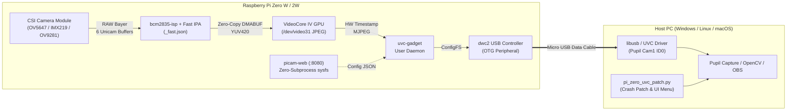

# 📷 Pi Zero UVC Camera & Pupil Labs Eye Tracker

[](https://www.raspberrypi.com/)
[](https://www.kernel.org/doc/html/latest/usb/gadget_configfs.html)
[](https://pupil-labs.com/)
[](LICENSE)
[](https://www.python.org/)

Turn your **Raspberry Pi Zero W** or **Pi Zero 2W** with a CSI camera into a high-performance **USB UVC Webcam** that behaves as an authentic **Pupil Labs Eye Tracking Camera (`Pupil Cam1 ID0/ID1/ID2`)** or a standard plug-and-play webcam.

Includes **120–190 FPS custom kernel driver mod**, **hardware MJPEG GPU streaming**, a browser-based **Web Control Panel (`:8080`)** with dynamic Fast-Crop switches, and an automatic **Pupil Capture plugin** with in-memory crash prevention and an in-app resolution/FPS selector.

---

## ✨ Features

- **🎯 Authentic Pupil Labs Emulation**: Full USB descriptors, VID/PID (`0x05a3:0x9230`), and serial numbers recognized immediately by **Pupil Capture** as `Pupil Cam1 ID0` (eye0), `ID1` (eye1), or `ID2` (world).
- **🏎️ 120–190 FPS Custom Kernel Driver Mod (OV5647)**:
  - Fixes the hardware ADC timing bottleneck in standard Linux `ov5647.c` ($HTS \ge 1730$) to prevent sensor grey/white-out.
  - Achieves **120 FPS live USB UVC streaming** (with a theoretical 190.95 FPS hardware mode) in center-crop mode, perfect for high-speed pupil tracking under infrared illumination.
- **🎯 Dynamic Per-Resolution Fast-Crop Switching**:
  - Automatically selects **Fast-Crop (120 FPS center-crop)** for `192x192` and `320x240`.
  - Automatically selects **Full FOV (wide-angle)** for `400x400`, `640x480` (90 FPS), and `1280x720`.
  - Interactive switches in Web UI (`:8080`) and REST API (`/api/fast_crop`) to toggle crop vs. full field of view per resolution on the fly.
- **🚀 Zero-Copy VideoCore IV GPU Hardware Encoding & High-FPS IPA Tuning**:
  - Passes `libcamera` ISP `YUV420` DMA buffers (`V4L2_MEMORY_DMABUF`) directly to the VideoCore IV hardware JPEG/MJPEG encoder (`/dev/video31` / `/dev/video11`) without CPU memory copies (**1.62 ms/frame @ 320x240**, **2.65 ms/frame @ 640x480**, reducing CPU load from 100% down to **~13.4%** on single-core Pi Zero W).
  - Automatically generates lightweight eye-tracking `libcamera` IPA tuning (`/etc/picam/<sensor>_fast.json`: `alsc n_iter=0`, `awb bayes=0`, `contrast ce_enable=0`, max shutter `16666 µs`) and Unicam buffer configuration (`/etc/picam/rpi_pipeline.yaml`: `min_unicam_buffers=6`), eliminating 24 ms 3A CPU stalls and VSYNC frame drops.
  - Propagates hardware sensor capture timestamps (`buf.timestamp`) to UVC headers for rock-solid **16.00 ms** median frame intervals in Pupil Capture (`120 FPS` @ `192x192` & `320x240`, `90 FPS` @ `640x480` on OV5647; up to `90–120 FPS` on OV9281).
  - Supports expanded presets (`192x192`, `320x240`, `400x400`, `640x480`, `800x600`, `1280x720`) and arbitrary custom resolutions.
- **🔌 Dual-Function Composite Gadget (Direct USB SSH)**: Simultaneously exposes both a UVC Webcam and an Ethernet adapter (RNDIS). Connect to SSH (`ssh pi@pizero.local`) and the web dashboard directly through the single USB cable without any Wi-Fi network!
- **🌐 Web Control Panel (:8080)**: On-device Flask web service to switch camera roles, flip orientation, adjust brightness/contrast, and restart services from any browser.
- **🌍 Multi-Wi-Fi Network Roaming**: Pre-configure multiple Wi-Fi networks (home router, mobile hotspot, lab); Pi Zero auto-connects to whichever is in range.
- **🛡️ Pupil Capture Windows Patch**:
  - Memory hotpatch for the notorious `uvc.dll` zero-division crash (`0xc0000094`).
  - `SafeSelector` monkey patch preventing PyGLUI Cython crashes when selecting resolutions.
  - Interactive **"Pi Zero Camera Settings"** menu inside Pupil Capture's Eye0 window.
- **⚡ 1-Command Installation**: Bulletproof installer detecting Raspberry Pi OS (Bookworm & Bullseye), automatically configuring boot overlays, compiling UVC gadget, and enabling systemd daemons.

---

## 🏗️ Architecture



---

## 📦 Hardware Requirements

| Component | Recommendation | Note |
|---|---|---|
| **Board** | Raspberry Pi Zero W or Pi Zero 2W | Built-in Wi-Fi enables the web control panel. |
| **Camera** | OV5647, IMX219, or OV9281 | OV5647 supports up to 120–190 FPS center-crop with custom driver; OV9281 supports 120 FPS global shutter. |
| **Flex Cable** | 15-pin to 22-pin mini CSI cable | Required for the smaller CSI port on Pi Zero. |
| **USB Cable** | **Micro USB Data Cable** | ⚠️ Must have data lines (D+/D-). Do **not** use charge-only cables! |
| **SD Card** | 8 GB+ Class 10 MicroSD | Raspberry Pi OS Lite (32-bit or 64-bit). |

> ⚠️ **CRITICAL USB CONNECTION**:  
> Pi Zero has two Micro USB ports. Connect the cable to the **middle USB (Data)** port, **NOT** the outer `PWR IN` port! The USB port supplies both power and data to the Pi Zero.

---

## 🚀 Quick Start (Pi Zero Installation)

### Step 1: Prepare SD Card
Flash **Raspberry Pi OS Lite** using [Raspberry Pi Imager](https://www.raspberrypi.com/software/).  
In OS Customization settings (`Ctrl + Shift + X`):
- Set Hostname: `pizero` (or your preferred name)
- Set Username & Password: e.g. `pi` / `raspberry`
- Enable Wi-Fi & SSH

### Step 2: SSH into Pi Zero & Run Installer
Once booted and connected to your network:

```bash
# 1. Connect via SSH
ssh pi@pizero.local
# (or ssh pi@<hostname>.local)

# 2. Clone the repository
git clone https://github.com/Kagawashi/Pi-Zero-UVC-Webcam.git

# 3. Run the automated installer
cd Pi-Zero-UVC-Webcam
sudo bash install.sh
```

*(The installer will configure `/boot/firmware/config.txt`, compile `uvc-gadget`, install services, and offer to reboot).*

---

## 💻 Windows & Pupil Capture Setup

To connect to **Pupil Capture** without crashes:

1. Open PowerShell on Windows and navigate to the `windows` folder:
   ```powershell
   cd windows
   powershell -ExecutionPolicy Bypass -File .\install_plugin.ps1
   ```
2. Plug the Pi Zero into your PC via the **USB data port**.
3. Launch Pupil Capture:
   ```powershell
   Start-Process "C:\Program Files (x86)\Pupil-Labs\Pupil v3.5.1\Pupil Capture v3.5.1\pupil_capture.exe" -ArgumentList "--skip-driver-installation"
   ```
4. In the **Eye 0 window**, press `C` to reveal the **Pi Zero Camera Settings** panel to adjust resolution (`640x480`, `1280x720`) and FPS (`15` to `90` / `120`).

---

## 🔍 What Gets Installed on the Pi Zero?

| Component | Destination | Description |
|---|---|---|
| **Kernel Overlays** | `/boot/firmware/config.txt` | `dtoverlay=dwc2,dr_mode=peripheral`, `gpu_mem=128`, `camera_auto_detect=1` |
| **High-FPS Driver** | `/lib/modules/$(uname -r)/.../ov5647.ko.xz` | Custom OV5647 driver mod for 120–190 FPS center crop with ADC timing fix ($HTS \ge 1730$). |
| **Kernel Modules** | `/etc/modules` & `cmdline.txt` | Loads `dwc2`, `libcomposite`, and `usb_f_rndis` for USB ConfigFS support. |
| **UVC Gadget Engine** | `/usr/local/bin/uvc-gadget` | Release (`-O3`) UVC daemon with zero-copy `V4L2_MEMORY_DMABUF` VideoCore IV GPU JPEG encoding (`/dev/video31`) and hardware timestamp propagation. |
| **ConfigFS Script** | `/usr/local/bin/setup-gadget.sh` | Builds the USB descriptors, formats (`192x192` to `1280x720`), and vendor identity. |
| **Stream Wrapper** | `/usr/local/bin/start-uvc.sh` | Manages per-resolution Fast-Crop selection, `libcamera` IPA tuning, and launches `uvc-gadget`. |
| **Driver Build Tool**| `/usr/local/bin/build-ov5647-driver.sh`| Compiles and installs the high-FPS kernel module out-of-tree. |
| **Fast IPA & Pipeline** | `/etc/picam/<sensor>_fast.json`, `rpi_pipeline.yaml` | Disables heavy iterative 3A solvers (`alsc n_iter=0`, `awb bayes=0`, `ce_enable=0`) and increases Unicam RAW buffers to `6`. |
| **Web Service** | `/opt/picam-web/` | Zero-subprocess (`sysfs`) Flask web control dashboard on port `8080` with Fast-Crop switches & API. |
| **Systemd Units** | `/etc/systemd/system/` | `uvc-gadget.service` and `picam-web.service` (auto-start on boot). |
| **Configuration** | `/etc/picam/config.json` | Persistent camera, role, and per-resolution Fast-Crop settings. |

---

## 🌐 Web Control Panel

Access the dashboard from any browser on the local network:
```
http://pizero.local:8080
# or http://<pi-zero-ip>:8080
```

- **Roles**: `eye0` (Pupil Eye 0), `eye1` (Pupil Eye 1), `world` (Scene Cam), `generic` (Standard UVC Webcam).
- **Per-Resolution Fast-Crop Switches**: Live interactive toggles for 192x192, 320x240, 400x400, 640x480, 800x600, 1280x720.
- **Controls**: Real-time Horizontal/Vertical Flip, Brightness, Contrast, Saturation, Sharpness.
- **REST API**: `/api/fast_crop`, `/api/config`, `/api/status`, `/api/restart`.
- **Service Management**: Instant service restart and hardware status monitoring.

---

## 🛠️ CLI Diagnostics

```bash
# Check UVC streaming service
sudo systemctl status uvc-gadget

# View live stream logs
sudo journalctl -u uvc-gadget -f

# Verify camera sensor
vcgencmd get_camera
v4l2-ctl --list-devices

# Verify USB Gadget status
sudo /usr/local/bin/setup-gadget.sh status
```

---

## 📄 License

This project is licensed under the [MIT License](LICENSE).
Pupil Labs is a registered trademark of Pupil Labs GmbH. This open-source project is independently developed for academic and developer applications.
