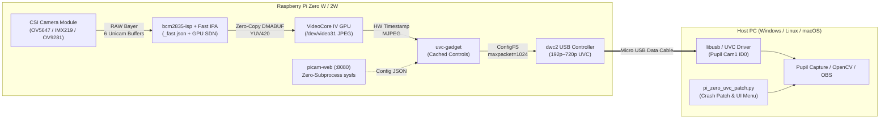

# 📷 Pi Zero UVC Camera & Pupil Labs Eye Tracker

[](https://www.raspberrypi.com/)
[](https://www.kernel.org/doc/html/latest/usb/gadget_configfs.html)
[](https://pupil-labs.com/)
[](LICENSE)
[](https://www.python.org/)

Turn your **Raspberry Pi Zero W** or **Pi Zero 2W** with a CSI camera into a high-performance **USB UVC Webcam** that behaves as an authentic **Pupil Labs Eye Tracking Camera (`Pupil Cam1 ID0/ID1/ID2`)** or a standard plug-and-play webcam.

Includes **120–190 FPS custom kernel driver mod**, **hardware MJPEG GPU streaming**, a browser-based **Web Control Panel (`:8080`)** with dynamic Fast-Crop switches, and an automatic **Pupil Capture plugin** with in-memory crash prevention and an in-app resolution/FPS selector.

---

## ✨ Features

- **🎯 Authentic Pupil Labs Emulation**: Full USB descriptors, VID/PID (`0x05a3:0x9230`–`0x9232`), and serial numbers recognized immediately by **Pupil Capture** as `Pupil Cam1 ID0` (eye0), `ID1` (eye1), or `ID2` (world).
- **🛡️ Zero Corrupt JPEG USB Transport (`streaming_maxpacket = 1024`)**: Configured for BCM2835 `dwc2` ISOC stability (`streaming_maxpacket=1024`, MJPEG frame buffers sized to $\max(w \times h, 65536)$), eliminating `-ENODATA` mid-frame packet drops and `Corrupt JPEG data: premature end of data segment` errors across all resolutions (`192x192` through `1280x720@30/15`).
- **🎯 Full FOV Default & Per-Resolution Fast-Crop Switching**:
  - Defaults `fast_crop: false` across all OV5647 resolutions (`192x192` to `1280x720`) to prevent sensor Bayer striping on `192x192`/`320x240`, scaling cleanly via VideoCore IV ISP hardware (`~69.3 FPS` @ `192x192`, `~67.5 FPS` @ `320x240`, `~58–60 FPS` @ `640x480`, `~29.2 FPS` @ `1280x720`).
  - Optional interactive switches in Web UI (`:8080`) and REST API (`/api/fast_crop`) to enable experimental `120–190 FPS` OV5647 center-crop mode (with custom $HTS \ge 1730$ kernel driver mod) per resolution on the fly.
- **🚀 Zero-Copy VideoCore IV GPU Encoding, Spatial Denoise & IPA Tuning**:
  - Passes `libcamera` ISP `YUV420` DMA buffers (`V4L2_MEMORY_DMABUF`) directly to VideoCore IV hardware MJPEG encoding (`/dev/video31` / `/dev/video11`).
  - Keeps **VideoCore IV GPU Spatial Denoise (`NoiseReductionModeFast` / `rpi.sdn`)** enabled to eliminate red/green/blue chroma noise, while caching runtime controls (`controls_applied_`) in `libcamera-source.cpp` to eliminate redundant per-frame IPA IPC overhead.
  - Generates eye-tracking `libcamera` tuning (`/etc/picam/<sensor>_fast.json`: strips `alsc`, `geq`, `contrast`, `sharpen`, sets `awb bayes=0` and `agc` max shutter `9500 µs`) and Unicam buffer pipeline (`/etc/picam/rpi_pipeline.yaml`: `min_unicam_buffers=6`), plus hardware capture timestamps (`buf.timestamp`).
  - Built-in UVC presets for `192x192`, `320x240`, `400x400`, `640x480`, `800x600`, `1280x720@30/15`, and arbitrary custom resolutions.
- **🔌 Optional USB Ethernet (`ENABLE_RNDIS`)**: Disabled by default (`ENABLE_RNDIS=0`) so `PupilDrvInst.exe` installs `libusbK` without Windows PnP hangs; can be enabled (`ENABLE_RNDIS=1`) when direct USB SSH is desired.
- **Web Control Panel (:8080) & Bilingual UI (`TR` / `EN`)**: On-device Flask web service with instant Turkish/English language switching (`/api/language`), displaying **CPU**, **estimated VideoCore IV ISP+M2M GPU Load**, **GPU Spatial Denoise & USB MaxPacket status**, live controls (`spatial_denoise`, `analogue_gain`, `exposure_value`, flip, AWB, Fast-Crop), resolution presets (`192x192` included), camera role selection, and service management.
- **🌍 Multi-Wi-Fi Network Roaming**: Pre-configure multiple Wi-Fi networks (home router, mobile hotspot, lab); Pi Zero auto-connects to whichever is in range.
- **🛡️ Pupil Capture Windows Patch**:
  - Memory hotpatch for the notorious `uvc.dll` zero-division crash (`0xc0000094`).
  - `SafeSelector` monkey patch preventing PyGLUI Cython crashes when selecting resolutions.
  - Interactive **"Pi Zero Camera Settings"** menu inside Pupil Capture supporting `192x192`, `320x240`, `400x400`, `640x480`, `800x600`, `1280x720` and quick FPS presets.
- **⚡ 1-Command Install & Remote Deploy**: Works both locally via `sudo bash install.sh` and remotely via `deploy.ps1` (`-SkipInstall -Compile` / `-Quick`) or `deploy.sh` (`-q -c` / `-q`), with automatic CRLF cleanup.

---

## 🏗️ Architecture



---

## 📦 Hardware Requirements

| Component | Recommendation | Note |
|---|---|---|
| **Board** | Raspberry Pi Zero W or Pi Zero 2W | Built-in Wi-Fi enables the web control panel. |
| **Camera** | OV5647, IMX219, or OV9281 | OV5647 supports up to 120–190 FPS center-crop with custom driver; OV9281 supports 120 FPS global shutter. |
| **Flex Cable** | 15-pin to 22-pin mini CSI cable | Required for the smaller CSI port on Pi Zero. |
| **USB Cable** | **Micro USB Data Cable** | ⚠️ Must have data lines (D+/D-). Do **not** use charge-only cables! |
| **SD Card** | 8 GB+ Class 10 MicroSD | Raspberry Pi OS Lite (32-bit or 64-bit). |

> ⚠️ **CRITICAL USB CONNECTION**:  
> Pi Zero has two Micro USB ports. Connect the cable to the **middle USB (Data)** port, **NOT** the outer `PWR IN` port! The USB port supplies both power and data to the Pi Zero.

---

## 🚀 Quick Start (Pi Zero Installation)

### Step 1: Prepare SD Card
Flash **Raspberry Pi OS Lite** using [Raspberry Pi Imager](https://www.raspberrypi.com/software/).  
In OS Customization settings (`Ctrl + Shift + X`):
- Set Hostname: `pizero` (or your preferred name)
- Set Username & Password: e.g. `pi` / `raspberry`
- Enable Wi-Fi & SSH

### Step 2: SSH into Pi Zero & Run Installer (or Remote Deploy)
Once booted and connected to your network:

```bash
# 1. Connect via SSH
ssh pi@pizero.local
# (or ssh pi@<hostname>.local)

# 2. Clone the repository
git clone https://github.com/Kagawashi/Pi-Zero-UVC-Webcam.git

# 3. Run the automated installer
cd Pi-Zero-UVC-Webcam
sudo bash install.sh
```

Or deploy remotely from your development PC:

```powershell
# Windows (PowerShell): full install or quick compile update
powershell -ExecutionPolicy Bypass -File .\deploy.ps1 -TargetHost pizero.local -Role eye0 -Sensor ov5647
powershell -ExecutionPolicy Bypass -File .\deploy.ps1 -TargetHost pizero.local -SkipInstall -Compile
```

```bash
# Linux / macOS:
./deploy.sh -H pizero.local -r eye0 -s ov5647
./deploy.sh -H pizero.local -q -c
```

*(The installer will configure `/boot/firmware/config.txt`, compile `uvc-gadget`, install services, and offer to reboot).*

---

## 💻 Windows & Pupil Capture Setup

To connect to **Pupil Capture** without crashes:

1. Open PowerShell on Windows and navigate to the `windows` folder:
   ```powershell
   cd windows
   powershell -ExecutionPolicy Bypass -File .\install_plugin.ps1
   ```
2. Plug the Pi Zero into your PC via the **USB data port**.
3. Launch Pupil Capture:
   ```powershell
   Start-Process "C:\Program Files (x86)\Pupil-Labs\Pupil v3.5.1\Pupil Capture v3.5.1\pupil_capture.exe" -ArgumentList "--skip-driver-installation"
   ```
4. In the **Eye 0 window**, press `C` to reveal the **Pi Zero Camera Settings** panel to adjust resolution (`192x192`, `320x240`, `400x400`, `640x480`, `800x600`, `1280x720`) and FPS presets (`192x192 @ 90`, `320x240 @ 90`, `640x480 @ 90/60`, `1280x720 @ 30`).

---

## 🔍 What Gets Installed on the Pi Zero?

| Component | Destination | Description |
|---|---|---|
| **Kernel Overlays** | `/boot/firmware/config.txt` | `dtoverlay=dwc2,dr_mode=peripheral`, `gpu_mem=128`, `camera_auto_detect=1` |
| **High-FPS Driver** | `/lib/modules/$(uname -r)/.../ov5647.ko.xz` | Custom OV5647 driver mod for 120–190 FPS center crop with ADC timing fix ($HTS \ge 1730$). |
| **Kernel Modules** | `/etc/modules` & `cmdline.txt` | Loads `dwc2` and `libcomposite` for USB ConfigFS support. |
| **UVC Gadget Engine** | `/usr/local/bin/uvc-gadget` | Release (`-O3`) UVC daemon with zero-copy `V4L2_MEMORY_DMABUF` VideoCore IV GPU JPEG encoding (`/dev/video31`), Spatial Denoise, cached IPA controls, and hardware timestamps. |
| **ConfigFS Script** | `/usr/local/bin/setup-gadget.sh` | Configures `streaming_maxpacket=1024`, MJPEG buffers ($\max(w \times h, 65536)$), built-in descriptors (`192x192` to `1280x720@30/15`), and Pupil/UVC vendor identity. |
| **Stream Wrapper** | `/usr/local/bin/start-uvc.sh` | Generates `libcamera` fast IPA tuning (`/etc/picam/<sensor>_fast.json`), Unicam buffers, sets default `fast_crop=0`, and launches `uvc-gadget`. |
| **Driver Build Tool**| `/usr/local/bin/build-ov5647-driver.sh`| Compiles and installs the high-FPS kernel module out-of-tree. |
| **Fast IPA & Pipeline** | `/etc/picam/<sensor>_fast.json`, `rpi_pipeline.yaml` | Keeps `rpi.sdn` Spatial Denoise, removes heavy `alsc/geq/contrast/sharpen`, sets `awb bayes=0`, caps `agc` max shutter at `9500 µs`, and raises Unicam RAW buffers to `6`. |
| **Web Service** | `/opt/picam-web/` | Flask web control dashboard on port `8080` with CPU/GPU load estimate, Spatial Denoise toggle, Analogue Gain, Manual Exposure, `192x192` preset, and Fast-Crop switches. |
| **Systemd Units** | `/etc/systemd/system/` | `uvc-gadget.service` and `picam-web.service` (auto-start on boot). |
| **Configuration** | `/etc/picam/config.json` | Persistent camera, role, exposure/gain/denoise, and per-resolution Fast-Crop settings (`false` by default). |

---

## 🌐 Web Control Panel

Access the dashboard from any browser on the local network:
```
http://pizero.local:8080
# or http://<pi-zero-ip>:8080
```

- **Roles**: `eye0` (Pupil Eye 0), `eye1` (Pupil Eye 1), `world` (Scene Cam), `generic` (Standard UVC Webcam).
- **Live Telemetry**: CPU temp & load, estimated VideoCore IV ISP+M2M GPU load (`gpu_load`), GPU Spatial Denoise & USB ISOC status (`usb_maxpacket`), camera & UVC node state.
- **Per-Resolution Fast-Crop Switches**: Live interactive toggles for `192x192`, `320x240`, `400x400`, `640x480`, `800x600`, `1280x720` (all `false` Full FOV by default).
- **Live Controls**: Horizontal/Vertical Flip, Auto Exposure, GPU Spatial Denoise (`spatial_denoise`), Analogue Gain (`1.0x–16.0x`), Manual Exposure (`exposure_value`), Brightness, Contrast, Saturation, Sharpness, AWB.
- **Bilingual Interface (`TR` / `EN`)**: Instant Turkish/English switcher in the header (`localStorage` + persisted via `/api/language`).
- **REST API**: `/api/fast_crop`, `/api/config`, `/api/language`, `/api/role`, `/api/sensor`, `/api/status`, `/api/service/<action>`, `/api/reboot`.
- **Service Management**: Instant service restart and hardware status monitoring.

---

## 🛠️ CLI Diagnostics

```bash
# Check UVC streaming service
sudo systemctl status uvc-gadget

# View live stream logs
sudo journalctl -u uvc-gadget -f

# Verify camera sensor
vcgencmd get_camera
v4l2-ctl --list-devices

# Verify USB Gadget status
sudo /usr/local/bin/setup-gadget.sh status
```

---

## 📄 License

This project is licensed under the [MIT License](LICENSE).
Pupil Labs is a registered trademark of Pupil Labs GmbH. This open-source project is independently developed for academic and developer applications.
